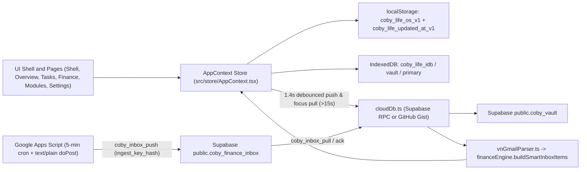

# Coby LIFE — Full Codebase Index

> Canonical structural and symbol map for `d:\CobyLife` (**Coby LIFE — Personal OS: Tasks · Finance**).
> Stack: **React 19.1.0**, **TypeScript 5.8.3**, **Vite 6.3.5**, **GSAP 3.15.1**, **Supabase PostgreSQL / GitHub Private Gist**, **Google Apps Script**.

---

## 1. Architecture & Data-Flow Overview

### Runtime Lifecycle (`src/main.tsx` → `src/App.tsx`)
1. `src/main.tsx` loads stylesheets in strict cascade order: `tokens.css` → `shell.css` → `views.css` → `motion.css`, then mounts `<App />`.
2. `src/App.tsx` wraps `<AppContent />` inside `<AppProvider>`.
3. If `locked` (`settings.pinEnabled`) is `true`, renders `<PinLockView />` + `<Toasts />`; otherwise renders `<Shell>` wrapping `<SwapView>` page switcher (`overview`, `tasks`, `finance`, `modules`, `settings`), `<Drawers />`, `<Modals />`, and `<Toasts />`.

---

## 2. Complete File & Symbol Map

### A. Build, Deploy & Entry Configuration
| File | Lines | Key Exports & Details |
|---|---:|---|
| `package.json` | 23 | Package `sylva-life-os` (`2.0.0`); scripts `dev`, `build` (`tsc && vite build`), `preview`; deps `gsap`, `react`, `react-dom`. |
| `tsconfig.json` | 20 | `ES2022`, `moduleResolution: "bundler"`, `strict: true`, `noEmit: true`, `jsx: "react-jsx"`, `include: ["src"]`. |
| `vite.config.ts` | 10 | `@vitejs/plugin-react`, `server: { port: 5173, strictPort: false }`. |
| `vercel.json` | 8 | SPA rewrite `/(.*) -> /index.html`. |
| `index.html` | 23 | `<html lang="en" data-theme="dark">`, title `Coby LIFE — Personal OS: Tasks · Finance`, Google Font `Urbanist` (`400;500;600;700`). |
| `.github/workflows/deploy-pages.yml` | 63 | Actions workflow (`push` to `main`): builds Vite with `--base "$BASE_PATH"`, copies `index.html` → `404.html`, touches `.nojekyll` *(note: custom workflows blocked by billing lock per `HANDOFF.md`; deploy via legacy `gh-pages` branch)*. |
| `src/main.tsx` | 13 | CSS import order (`tokens` → `shell` → `views` → `motion`) and React 19 `createRoot` mount. |
| `src/App.tsx` | 51 | `App` (L45, default L51); `AppContent` (L15–43) switching between `PinLockView` and `Shell` + `SwapView` pages. |

### B. Core Types, Store, Registry & Seed Data
| File | Lines | Key Exports & Details |
|---|---:|---|
| `src/types.ts` | 247 | All domain types & discriminated unions (`ThemeMode`, `CurrencyCode`, `PageId`, `ModuleId`, `TaskItem`, `FinanceWallet`, `FinanceCategory`, `FinanceTransaction`, `TxSplitInfo`, `GmailInboxItem`, `FinanceAutoRule`, `FinanceRecurringBill`, `QuickPreset`, `FinanceState`, `FutureModuleIdea`, `AppSettings`, `PersistedAppState`, `DrawerState`, `ModalState`, `ToastItem`). |
| `src/modules/registry.ts` | 53 | `ModuleDefinition` (L3–13), `APP_MODULES` (`tasks`, `finance` — L22–45), `MODULE_MAP` (L47–53). |
| `src/data/seedData.ts` | 306 | `DEFAULT_FINANCE_CATEGORIES` (L14–26, 11 items), `DEFAULT_WALLETS` (L28–62, 4 wallets), `DEFAULT_FUTURE_IDEAS` (L64–97), `createStarterState` (L104–283, v3), `createEmptyPersonalState` (L285–306). |
| `src/store/AppContext.tsx` | 2032 | `RouteState` (L55), `parseLocation` (L87), `buildUrl` (L106), `ReconcileOptions` (L123), `ApproveInboxOptions` (L132), `AppProvider` (L232–2026), `useApp` (L2028–2032). |

### C. Utilities (`src/utils/`)
| File | Lines | Key Exports & Details |
|---|---:|---|
| `src/utils/storage.ts` | 132 | `APP_STORAGE_KEY` (`'coby_life_os_v1'`, L9), `LOCAL_UPDATED_AT_KEY` (`'coby_life_updated_at_v1'`, L11), `hasStoredAppState` (L13), `getLocalUpdatedAt` (L24), `setLocalUpdatedAt` (L32), `normalizePersistedState` (L40), `loadAppState` (L100), `saveAppState` (L117), `clearAppState` (L125). |
| `src/utils/cloudDb.ts` | 977 | `CloudProvider`, `CloudDbConfig`, `CloudSyncStatus`, `UnifiedVaultPayload`, `CLOUD_CONFIG_KEY` (`'coby_cloud_db_config_v1'`, L35), `DEFAULT_CLOUD_CONFIG` (L55), `SUPABASE_SETUP_SQL` (L69–304), `generateRandomSecret` (L40), `loadCloudConfig` (L306), `saveCloudConfigToStorage` (L317), `isCloudConfigValid` (L325), `encodeCloudConfigCode` (L340), `decodeCloudConfigCode` (L349), `saveLocalIdbSnapshot` (L387), `loadLocalIdbSnapshot` (L409), `pullFromCloudDb` (L437), `pushToCloudDb` (L492), `normalizeGasExecUrl` (L556), `registerSupabaseIngestKey` (L563), `pullSupabaseInboxItems` (L597), `ackSupabaseInboxItems` (L637), `triggerGasWebAppSync` (L691), `generateGoogleAppsScriptCode` (L745). |
| `src/utils/assets.ts` | 12 | `assetUrl` (L1–12): prefixes `import.meta.env.BASE_URL` for local assets while preserving `https://`/`data:`/`blob:`. |
| `src/utils/financeEngine.ts` | 753 | `DEFAULT_AUTO_RULES` (L14–78, 9 rules), `DEFAULT_QUICK_PRESETS` (L80–87, 6 presets), `DEFAULT_RECURRING_BILLS` (L89–138, 4 bills), `VN_BANK_GMAIL_GUIDE` (L148–191, 6 guide entries), `currentCycleKey` (L220), `getCycleRange` (L236), `isTxInCycle` (L292), `getEffectiveExpense` (L303), `getEffectiveIncome` (L312), `computeSafeToSpend` (L331), `detectAllWalletDrifts` (L432), `buildSmartInboxItems` (L582–753). |
| `src/utils/vnGmailParser.ts` | 515 | `RawGmailPayloadItem` (L3), `ParsedGmailAlert` (L20), `linearizeEmailBody` (L47), `isNoiseOrOtpText` (L86), `parseMoneyNumber` (L111), `parseVietnameseGmailAlert` (L285–462), `createSampleGmailDemoPayloads` (L469–515, 5 demo alerts). |
| `src/utils/format.ts` | 208 | `localIsoDate` (L6), `addDaysIso` (L13), `currentMonthKey` (L20), `shiftMonthKey` (L24), `formatMonthLabel` (L30), `formatMonthShort` (L35), `formatShortDate` (L40), `formatFullDate` (L47), `relativeDueLabel` (L51), `formatMoney` (L63), `formatMoneyCompact` (L76), `parseSmartAmount` (L149–166), `getInitials` (L168), `greetingEn` (L175), `TASK_STATUS_META` (L182), `TASK_PRIORITY_META` (L188), `TASK_CATEGORY_META` (L194), `WALLET_KIND_LABEL` (L202). |
| `src/utils/motion.ts` | 452 | Re-exports `gsap`, `Flip` (L8); `isReducedMotion` (L10), `isMobileViewport` (L17), `isDesktopShell` (L21), `isFinePointer` (L25), `dur` (L32), `clamp01` (L36), `lerp` (L40), `easeOutCubic` (L44), `easeInOutCubic` (L49), `Spring` (L56–92, 240 Hz sub-stepped), `animateHeadline` (L97), `animateKpis` (L133), `animateCards` (L161), `animateRows` (L194), `animateCountUp` (L221), `animateFlashPop` (L259), `animateIconBounce` (L276), `spawnFloatUp` (L290), `animateClipPill` (L327–394), `animateStampSlam` (L399), `animateErrorShake` (L411), `useStaggerEntrance` (L420), `useScrollReveal` (L439). |

### D. Shared UI, Motion & Finance Modals (`src/components/`)
| File | Lines | Key Exports & Details |
|---|---:|---|
| `src/components/Shell.tsx` | 1269 | `Shell` (L72–1269): backdrop, `.flyers` overlay (`MOD_COUNT=2`, `NAV_COUNT=4`, `TOTAL_SIDE_ITEMS=12`, `TOTAL_FLYERS=8`, `FLYER_TO_SIDE_IDX=[2,3,5,6,7,8,9,10]`), collapsed `.dock`, glass `.side`, mobile `.scrim`, topbar + popovers (Modules, New, Account), keyboard shortcuts (`Cmd/Ctrl+K`, `Cmd/Ctrl+\`, `Esc`, `?`). |
| `src/components/Motion.tsx` | 697 | `AnimatedTitle` (L24), `SwapView` (L73), `TabOption` (L129), `SlidingTabs` (L141), `SegOption` (L213), `SlidingSeg` (L229), `MagneticButton` (L313), `AnimatedNumber` (L373), `QuotaRing` (L397), `AnimatedPopover` (L466), `SlidingSegmented` (L580), `AnimatedModal` (L604), `AnimatedDrawer` (L650). |
| `src/components/Drawers.tsx` | 477 | `Drawers` (L14–477): Task editor drawer (L50–252) & Transaction editor + split settlement drawer (L254–474). |
| `src/components/Modals.tsx` | 947 | `Modals` (L891–947): `SearchModal` (L39), `NewTaskModal` (L174), `NewTransactionModal` (L333), `NewWalletModal` (L618), `NewIdeaModal` (L758), `ShortcutsModal` (L857) + dispatches 6 modals from `FinanceModals.tsx`. |
| `src/components/finance/FinanceModals.tsx` | 1253 | `QuickLogModal` (L29), `GmailSetupModal` (L309), `ReconcileWalletModal` (L647), `ManageCategoriesModal` (L833), `ManageRulesModal` (L954), `RecurringBillModal` (L1079). |
| `src/components/finance/GmailInboxView.tsx` | 574 | `GmailInboxView` (L379–574) + internal `GmailReviewCard` (L33–377): Sync, Approve All, Paste Email, 5-email Demo loader, inline Drift fix, Split, Remember Rule. |
| `src/components/Icons.tsx` | 298 | 39 inline SVG icon components (`IconSylvaMark`, `IconTasks`, `IconWallet`, `IconModules`, `IconModuleGlyph`, `IconOverview`, `IconSettings`, etc.). |
| `src/components/PinLockView.tsx` | 78 | `PinLockView` (L8–78): full-screen numeric PIN prompt calling `unlockApp(pin)`. |
| `src/components/Toasts.tsx` | 75 | `Toasts` (L63–75): `document.body` portal at `z-index: 400` with GSAP enter/undo-exit (`ToastRow` L8–61). |
| `src/components/Avatar.tsx` | 32 | `RepAvatar` (L12) & `ContactAvatar` (L24). |

### E. Pages (`src/components/pages/`) & Styles (`src/styles/`)
| File | Lines | Key Exports & Details |
|---|---:|---|
| `src/components/pages/OverviewPage.tsx` | 638 | `OverviewPage` (L38–638): 4 KPI cards (`Tasks today`, `Spent this month`, `Total balance`, `Monthly net`) + 4 Bento cards (`Today's tasks`, `Cashflow & Budgets`, `Wallets & Balances`, `Personal Modules`). |
| `src/components/pages/TasksPage.tsx` | 545 | `TasksPage` (L23–545): Quick-add bar, category/priority/search filters, `agenda` / `board` (HTML5 drag-and-drop `.deal-card` Kanban) / `list` views. |
| `src/components/pages/FinancePage.tsx` | 1370 | `FinancePage` (L48–1370): Payday cycle stepper, 5 tabs (`overview`, `inbox`, `transactions` + CSV export, `budgets` + recurring bills, `wallets` + drift alerts), desktop quick-add bar, mobile `.fin-fab`. |
| `src/components/pages/ModulesPage.tsx` | 183 | `ModulesPage` (L14–183): Active modules toggle cards (`APP_MODULES`) + Extension Roadmap `Module #3+` (`state.futureModules`). |
| `src/components/pages/SettingsPage.tsx` | 854 | `SettingsPage` (L33–854): 5 tabs (`profile`, `database`, `appearance`, `security`, `data`). |
| `src/styles/tokens.css` | 191 | Theme vars: Light Milk Glass (`:root`) & Dark Smoked Glass (`:root[data-theme='dark']`), `--font: 'Urbanist'`, `--accent: #c4ef4f`, radii & shell dimensions. |
| `src/styles/motion.css` | 265 | Headline mark bar, `.side__pill`, `.tabs__pill`, `.seg__thumb`, `.flyers`, `.float-up`, `.dcard--ghost`. |
| `src/styles/shell.css` | 1599 | `.backdrop`, `.dock`, `.side`, `.main`, `.top`, `.popover`, `.modal`/`.drawer` sheets, `.signin-wrap`, `.toasts`, responsive breakpoints (`1180`, `980`, `820`, `760`, `560`, `360`). |
| `src/styles/views.css` | 2943 | Bento/KPI/Task Kanban/Finance Pace Hero/Gmail Inbox/Budget/Wallet/Settings views & mobile `.fin-fab` (`<=1280`, `<=1080`, `<=1020`, `<=900`, `<=820`, `<=760`, `<=640`). |

---

## 3. Domain Data Model & Storage Keys

### Storage Locations
| Medium | Key / Store | Contents |
|---|---|---|
| `localStorage` | `coby_life_os_v1` | Serialized `PersistedAppState` (`version: 3`). Auto-migrates legacy `sylva_personal_os_v2` in `loadAppState()`. |
| `localStorage` | `coby_life_updated_at_v1` | Latest local mutation/sync ISO-8601 timestamp (`LOCAL_UPDATED_AT_KEY`). |
| `localStorage` | `coby_cloud_db_config_v1` | Serialized `CloudDbConfig` (`CLOUD_CONFIG_KEY`) — credentials remain device-local only. |
| `localStorage` | `coby_life_sidebar_v1` | Desktop sidebar expanded/collapsed preference (`Shell.tsx` L52). |
| `IndexedDB` | DB `coby_life_idb` (v1), store `vault`, key `primary` | `UnifiedVaultPayload` `{ format: 'coby-life-backup-v1', updatedAt, personalOs }`. |

---

## 4. Core Subsystems Deep Reference

### A. `AppContext` Store (`src/store/AppContext.tsx`)
- **State & Persistence:** Initializes `state` via `loadAppState()` and `locked` via `settings.pinEnabled`. On every non-initial `state` change, persists to `localStorage`, updates `LOCAL_UPDATED_AT_KEY`, writes IDB snapshot, and schedules `pushToCloudDb` after **1400ms** (`skipNextPushRef` prevents echo pushes after remote pulls).
- **Hydration & Focus Pull:** On mount, falls back to IDB if `localStorage` is empty; pulls remote cloud vault if `remote.updatedAt > localTs` (or seeds remote if missing); drains pending Supabase Gmail inbox items. Window `focus` re-pulls remote vault & inbox throttled at **>15000ms**.
- **Action Groups:**
  - *UI & Auth:* `navigate`, `openDrawer`/`closeDrawer`, `openModal`/`closeModal`, `pushToast`/`dismissToast`, `setTheme`/`toggleTheme`, `unlockApp` (`pin.trim() === settings.pinCode`), `lockApp`, `updateProfile`, `updateSettings`, `toggleModuleEnabled`.
  - *Tasks:* `createTask`, `updateTask`, `setTaskStatus` (handles recurring task rollover on `'done'`), `toggleTaskDone`, `toggleTaskPinned`, `deleteTask`, `addSubtask`, `toggleSubtask`, `deleteSubtask`.
  - *Finance:* `walletBalances`, `createTransaction`, `updateTransaction`, `deleteTransaction`, `createWallet`, `updateWallet`, `deleteWallet`, `reconcileWalletBalance`, `setCategoryBudget`, `createCategory`, `updateCategory`, `deleteCategory`, `saveAutoRule`, `deleteAutoRule`, `saveRecurringBill`, `deleteRecurringBill`, `markBillPaid`, `setPaydayDay`, `setUsdVndRate`, `settleSplitTransaction`.
  - *Gmail & Cloud:* `syncGmailInbox`, `importRawGmailText`, `loadSampleGmailDemo`, `updateInboxItem`, `approveInboxItem`, `approveAllMatchedInbox`, `ignoreInboxItem`, `saveCloudConfig`, `disconnectCloudDb`, `syncCloudNow`, `pushCloudNow`, `pullCloudNow`, `exportUnifiedBackup`, `importUnifiedBackup`, `clearToEmpty`, `resetStarterData`.

### B. Personal Finance v3 Engine (`src/utils/financeEngine.ts`, `vnGmailParser.ts`, `format.ts`)
1. **Shorthand & Currency Parsing (`format.ts`):**
   - `formatMoney` / `formatMoneyCompact`: `VND` (`1,500,000 ₫`, `k ₫`, `M ₫`, `B ₫`) and `USD` (`$20`, `$19.99`, `K`, `M`).
   - `parseSmartAmount`: evaluates inline `+`/`-` math and shorthand suffixes: `ty`/`tỷ`/`b` (`×1e9`), `tr`/`trieu`/`triệu`/`cu`/`củ`/`m` (`×1e6`), `lit`/`lít` (`×1e5`), `xi`/`xị` (`×1e4`), `k`/`ng`/`nghìn`/`nghin` (`×1e3`).
2. **Payday Cycle (`1–28`) & Safe-to-Spend (`financeEngine.ts`):**
   - `currentCycleKey` & `getCycleRange` shift billing boundaries to day `p` (`1..28`); `computeSafeToSpend` separates `totalPersonalExpense` (`getEffectiveExpense`) from `budgetedSpent` (budgeted categories only), computing `safeToday = Math.floor(remainingPool / divisorDays)`, `idealPct`, `actualPct`, and `paceStatus` (`'on-pace' | 'watch' | 'over-pace' | 'unbudgeted'`).
   - Recurring bills (`VND` or `USD` converted via `usdVndRate`, `yearly` divided by `12`) roll into `unpaidBillsTotal`.
3. **VN Gmail Parser & Smart Inbox (`vnGmailParser.ts` + `buildSmartInboxItems`):**
   - `linearizeEmailBody` (NFC + HTML table/block cleanup) + `isNoiseOrOtpText` (drops OTPs, login alerts, undelivered COD confirmations).
   - Recognizes 14 banks (`TIMO`, `ACB`, `STB`, `HSBC`, `VCB`, `TPB`, `VIB`, `CAKE`, `VPB`, `BIDV`, `UOB`, `SHINHAN`, `TCB`, `MB`), 3 e-wallets (`MOMO`, `ZALOPAY`, `SHOPEEPAY`), and 9 merchant receipt domains (`GRAB`, `XANHSM`, `BE`, `APPLE`, `GPLAY`, `SHOPEE`, `LAZADA`, `SAAS`, `VNPAY`), extracting USD/VND amounts, `accountLast4`, and `reportedBalanceAfter`.
   - `buildSmartInboxItems` applies: message-ID dedup → wallet & heuristic category inference → sequential `finance.rules` matching → unpaid recurring bill matching → open split repayment matching → merchant e-receipt enrichment (±`2,000` VND, ±`1` day) → 2-sided self-transfer collapsing (out + in, equal amount, distinct wallets, within `±20` min).
   - `detectAllWalletDrifts` flags `>= 1,000` VND discrepancy between computed balance + pending alerts (or `lastReportedBalance`) vs bank-reported balance.

### C. Cloud DB & Apps Script (`src/utils/cloudDb.ts`)
- **Supabase (`SUPABASE_SETUP_SQL`):** Uses `pgcrypto` SHA-256 (`secret_hash`, `ingest_key_hash`) and 6 `security definer` RPCs (`coby_vault_pull`, `coby_vault_push`, `coby_vault_set_ingest_key`, `coby_inbox_push`, `coby_inbox_pull`, `coby_inbox_ack`). `coby_inbox_push` uses write-only `ingest_key_hash` so Google Apps Script cannot read `coby_vault`.
- **GitHub Private Gist:** Stores `coby-life-db.json` via `GET`/`POST`/`PATCH` on `https://api.github.com/gists`.
- **Device Pairing (`COBYDB:...`):** `encodeCloudConfigCode` / `decodeCloudConfigCode` UTF-8 + Base64-encodes `CloudDbConfig` for 1-paste sync to mobile browsers.
- **GAS `doPost`:** `triggerGasWebAppSync` POSTs `Content-Type: text/plain;charset=utf-8` (CORS-safelisted simple request, avoiding preflight on mobile browsers) to normalized `/exec` URL (`sync_now` | `pull_direct` | `ack_direct`).

### D. Motion & CSS Z-Index Hierarchy (`src/components/Shell.tsx`, `Motion.tsx`, `motion.ts`, `styles/*.css`)
- **240 Hz Spring & Morph:** `Shell.tsx` couples a 240 Hz `Spring` (`stiffness=24, damping=7.6`) with `gsap.ticker` to morph `.flyers` (`MOD_COUNT=2` module stack tiles + `6` glyphs) between `.dock`/`.stack` and `.side`, using `stackFade = clamp01(1 - o * 2.2)` so topbar stack tiles fade cleanly when opening mobile sidebar.
- **UI Invariants:**
  - `animateClipPill` reads layout-space `offsetLeft/offsetTop/offsetWidth/offsetHeight` (immune to transform/scroll).
  - `animateIconBounce` animates inner `<svg>` only — never scales text buttons.
- **Exact Z-Index Stack:** `-1` `.phead__mark-bar` < `0` `.backdrop`/pills < `1` `.scroll`/`.signin-wrap` < `2` `.top` < `10` `.main` < `20` desktop `.side` < `25` `.dock` < `30` `.flyers` < `85` `.fin-fab` < `95` mobile `.scrim` < `98` mobile `.side` < `140` `.dock-tip` < `160` `.popover` < `200` `.drawer-backdrop` < `250` `.modal-backdrop` < `400` `.toasts` < `450` `.float-up` < `500` `.dcard--ghost`.

---

## 5. Common Engineering Recipes

1. **Add Module `#3+`:**
   - Add ID to `ModuleId` & `PageId` in `src/types.ts` (and `VALID_PAGES` / `DEFAULT_SUB` in `src/store/AppContext.tsx`).
   - Register in `src/modules/registry.ts` (`APP_MODULES`, `MODULE_MAP`).
   - Mount page inside `SwapView` in `src/App.tsx`; update `MODULE_IDS`, `MOD_COUNT`, `NAV_IDS`, `FLYER_TO_SIDE_IDX`, and `.flyers` in `src/components/Shell.tsx` if promoted to top-level navigation.
2. **Add a VN Bank / Merchant Parser:**
   - Add sender rules in `src/utils/vnGmailParser.ts` (L131–220) + domain to `ALLOWED_DOMAINS` in `generateGoogleAppsScriptCode` (`src/utils/cloudDb.ts` L745+), and optional guide entry in `VN_BANK_GMAIL_GUIDE` (`src/utils/financeEngine.ts` L148–191).
3. **Build & Deploy to Live GitHub Pages (`gh-pages` branch):**
   - Run `npx tsc && npx vite build --base /CobyLife/`, copy `dist/index.html` → `dist/404.html`, create `dist/.nojekyll`, and push `dist/` contents to `gh-pages` branch (do NOT commit `dist/` or `node_modules/` to `main`).
